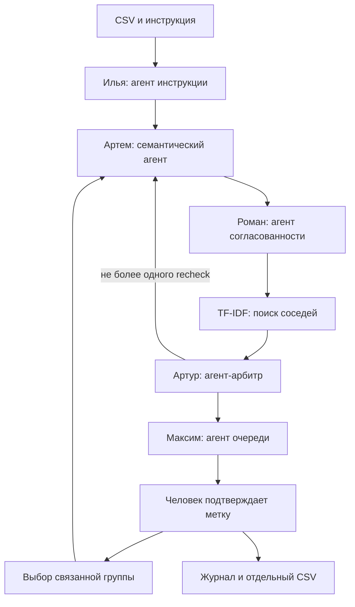

# Архитектура и контракты

Вход: UTF-8 CSV `id,text,label` и версия инструкции `data/taxonomy.json`. Пять классов: оплата, доставка, аккаунт, работа приложения, возврат. Выход: рекомендации, ограниченная очередь, журнал действий и отдельный CSV с ручными исправлениями.

Это централизованный workflow с условными переходами. Агентные решения реализованы в отдельных модулях; запуском и сохранением состояния управляет оркестратор. Это не децентрализованные автономные процессы. В режиме `llm` роли используют общую выбранную модель с разными задачами и контрактами; это не пять независимо обученных моделей. В режиме `demo` тот же маршрут использует правила и поиск.

| Агент | Вход | Решение | Инструмент | Выход |
|---|---|---|---|---|
| Инструкция | классы, правила, версия | есть ли пересечения и вопросы | проверка структуры и поиск совпадающих признаков | спецификация, issues, questions, SHA-256 |
| Семантика | текст и спецификация, без старой метки | один класс, несколько или воздержание; нужны ли соседи | чтение определений; повторный просмотр пакета соседей | labels, confidence, дословная evidence, reason, needs_neighbors |
| Согласованность | строка, семантическая оценка, индекс | значимо ли различие меток похожих текстов | top-4 по TF-IDF символьных триграмм | conflict, neighbor_ids, reason, neighbors |
| Арбитр | два заключения и инструкция | keep/change/review/recheck | максимум один повтор семантической проверки | action, proposed_label, confidence, reason |
| Очередь | рекомендации, бюджет, ручные решения | какие случаи выбрать и какую группу пересмотреть | ранжирование, ограничение бюджета, поиск прямых и обратных соседей | selected_ids, remaining_ids, related_ids, reason |

## Общие ограничения

- `confidence` — сигнал агента, не откалиброванная вероятность. Число должно быть конечным и находиться в [0, 1].
- Цитата должна дословно встречаться в исходном тексте; ссылки на соседей — принадлежать результатам поиска.
- Много тем или недостаток сведений ведут к человеку. `change` допускается только для одного класса при confidence ≥0,65 и согласии с семантической оценкой.
- `recheck` разрешен один раз на строку. Второй запрос превращается в `review`.
- Очередь выбирает не больше бюджета; в LLM-пакет передаются до 80 наиболее приоритетных кандидатов. Для больших наборов потребуется пакетная стратегия.
- Полученный JSON проверяется в Python. Некорректный ответ вызывает явную ошибку; автоматической подмены LLM эвристикой нет.

## Обратная связь

Подтверждение пользователя сохраняется отдельным событием. Агент очереди выбирает прямых и обратных соседей со сходством ≥0,62. Оркестратор повторяет их семантическую проверку, проверку согласованности и арбитраж, после чего агент очереди перераспределяет бюджет. Исправление не переносится на соседей автоматически. Проверенная человеком строка исключается из очереди. При ошибке повторной проверки исходное состояние остается целым.

`input_records` неизменяемы. `reviewed.csv` собирается из исходных строк и последних ручных решений. `report.json` и `trace.jsonl` содержат наблюдаемые решения, а не скрытые рассуждения модели.

## Выбор стека

Python и стандартная библиотека сокращают требования к запуску на защите. Для небольшого CSV достаточно файлов JSON/CSV и символьного TF-IDF. Числа, метрики и бюджет считает код. Задачи понимания намерения и разбора противоречий в живом режиме передаются LLM. HTTP-сервер предназначен только для локального прототипа и не является промышленным backend.

LangGraph, embeddings и база данных не включены в обязательный объем КП2. Их имеет смысл добавлять после измерения качества и стоимости, а не ради количества технологий.

## Известные ограничения

Эвристика не понимает отрицания, контекст и иронию. Например, «Доставка уже в порядке, проблема только с оплатой» может ошибочно попасть в review. Для прозрачности это ограничение не исправлено подбором специальных правил под проверочную часть. Символьное сходство не доказывает равенство намерений. Общая модель может повторять одну ошибку во всех ролях. Полноценная калибровка confidence и оценка на реальных данных запланированы к финалу.

